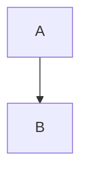

# cargo-rdme-with-mermaid

[](https://crates.io/crates/cargo-rdme-with-mermaid)
[](https://docs.rs/cargo-rdme-with-mermaid)
[](https://github.com/rockyyliang/cargo-rdme-with-mermaid/actions/workflows/ci.yml)

<!-- cargo-rdme start -->

Cargo command to create your README from your crate’s documentation, like
[cargo-rdme](https://crates.io/crates/cargo-rdme), with
[simple-mermaid](https://crates.io/crates/simple-mermaid) diagrams expanded inline.

`cargo rdme` skips doc attributes whose value is a macro, so a diagram written as
`#![doc = simple_mermaid::mermaid!("diagram.mmd")]` silently disappears from the README.
`cargo rdme-with-mermaid` reads those attributes from the Rust syntax tree and inserts each
diagram as a fenced `mermaid` block at the position of its attribute, then runs cargo-rdme’s own
transformations and README injection. GitHub, GitLab and most Markdown renderers draw these
blocks as diagrams.

## Installation

```bash
cargo install cargo-rdme-with-mermaid --locked
```

No separate `cargo-rdme` installation is needed: the cargo-rdme library is a dependency.

## Usage

Add a marker to your README where the crate documentation should go:

```markdown
# my-crate

[](https://example.org/ci)

<!-- cargo-rdme -->
```

Then run, from anywhere inside your package:

```bash
cargo rdme-with-mermaid           # write the README
cargo rdme-with-mermaid --check   # verify it is up to date, without writing
```

The first run replaces the marker with a `<!-- cargo-rdme start -->` …
`<!-- cargo-rdme end -->` region. Later runs only replace the content of that region; everything
outside of it is preserved.

Common options (all `cargo rdme` flags are accepted):

| Flag | Meaning |
|------|---------|
| `--check`, `-c` | Compare the generated README with the file; never write. |
| `--manifest-path <PATH>` | Use this `Cargo.toml` instead of discovering one from the current directory. |
| `--workspace-project <NAME>`, `-w` | Document this workspace member (needed for virtual workspaces). |
| `--entrypoint <auto\|lib\|bin\|bin:NAME>` | Which target’s source file to read. Custom `[lib] path` and `[[bin]] path` are honored. |
| `--readme-path <PATH>`, `-r` | README file to update (default: the `readme` field of `Cargo.toml`, or `README.md`). |
| `--line-terminator <auto\|lf\|crlf>` | Line endings of the written README (`auto` keeps the README’s predominant ones). |
| `--heading-base-level <N>` | Levels added to the documentation’s headings (default: nest under the README section containing the marker). |
| `--intralinks-strip-links` | Replace intralinks with their text instead of resolving them. |
| `--intralinks-all-features`, `--intralinks-features <A,B>`, `--intralinks-no-default-features` | Features for the rustdoc run that resolves intralinks. |
| `--no-fail-on-warnings` | With `--check`, do not fail because of warnings. |
| `--force`, `-f` | Write even if the README has uncommitted changes. |

Exit codes match cargo-rdme:

| Code | Meaning |
|------|---------|
| 0 | Success / README up to date. |
| 1 | Error (invalid input, missing diagram, unsupported syntax, …). |
| 2 | README not written because it has uncommitted changes or is untracked (use `--force`). |
| 3 | `--check`: README is stale. |
| 4 | `--check`: README is up to date but warnings were emitted. |

### CI

```yaml
- name: Check that the README is up to date
  run: |
    cargo install cargo-rdme-with-mermaid --locked
    cargo rdme-with-mermaid --check
```

Use this *instead of* `cargo rdme --check`: plain cargo-rdme ignores the diagrams and would
report a mismatch for every README that contains one.

## README generation and cargo doc

For `#![doc = simple_mermaid::mermaid!("diagram.mmd")]`:

* **README extraction** parses the invocation and reads the file without executing the macro;
  your crate does not need a `simple-mermaid` dependency for this stage.
* **`cargo doc`** expands the macro, so your crate must depend on `simple-mermaid`. Installing
  this command does not add that dependency. Browser rendering loads Mermaid JavaScript from a CDN.

Resolving intralinks also invokes rustdoc and requires a compilable crate. Use
`--intralinks-strip-links` to skip that build.

For both workflows, add the dependency, create `src/diagram.mmd`, and reference it from
`src/lib.rs` using the source syntax below:

```bash
cargo add simple-mermaid@0.2
cargo rdme-with-mermaid --intralinks-strip-links
cargo doc --no-deps --open
```

Ordinary fenced `mermaid` blocks need no dependency and pass through to the README, but plain
`cargo doc` displays them as code rather than diagrams.

## Source syntax

Write the diagram reference as a crate-level (inner) doc attribute, between ordinary doc
comments:

```rust
//! # Architecture
//!
#![doc = simple_mermaid::mermaid!("diagram.mmd")]
//!
//! # Usage
```

With `diagram.mmd` next to the Rust file, the README gets:

````markdown
# Architecture



# Usage
````

The rules are:

* **Macro path**: `mermaid!`, `simple_mermaid::mermaid!` or `::simple_mermaid::mermaid!`, with
  any delimiter (`()`, `[]`, `{}`). Renamed imports (`use simple_mermaid::mermaid as m;`) are
  not recognized.
* **Arguments**: exactly one string literal (raw strings allowed), optionally followed by
  simple-mermaid’s rendering keywords: one of `left`, `center`, `right`, and/or `framed`, in
  either order. The keywords are validated and accepted but do not change the README, because
  Markdown code blocks cannot express alignment or frames.
* **Paths** are resolved like `include_str!`: relative to the directory of the Rust file that
  contains the attribute (absolute paths are used as is). Nothing else needs to be configured.
* **Position**: each diagram replaces its attribute, so it appears exactly where rustdoc shows
  it. Any number of diagrams can be used, and the same file can be referenced more than once.
* **Fences** use backticks and are always longer than the longest backtick run in the diagram,
  so diagram content cannot terminate the block. Diagram line endings are normalized and
  trailing newlines removed.
* Only the crate root’s **inner** attributes are read, as in cargo-rdme. Text inside doc
  comments — such as the code example above — is just text and is never expanded.

The following are reported as errors, with the file, line and column, rather than being
silently dropped:

* a missing or unreadable diagram file (the error shows both the written and the resolved
  path);
* a `mermaid!` argument that is not a string literal (e.g. `concat!(…)` or a constant), unknown
  or repeated keywords, or extra tokens;
* a `mermaid!` invocation anywhere else in a crate-level attribute, for example inside
  `#![cfg_attr(doc, doc = mermaid!("…"))]` or nested in another macro.

The extraction stage never executes macros. Other macro-valued doc attributes, such as
`#![doc = include_str!("../README.md")]`, are skipped exactly as cargo-rdme skips them.

## How it works

```mermaid
flowchart LR
    src["Entry file<br/>(src/lib.rs or main.rs)"] --> parse["syn: crate-level<br/>#![doc] attributes"]
    parse --> text["String literals<br/>(//! and /*! */)"]
    parse --> mmd["simple_mermaid::mermaid!(#quot;file#quot;)"]
    mmd --> read["Read file relative to<br/>the invoking .rs file"]
    read --> fence["Fenced mermaid block"]
    text --> doc["Markdown doc"]
    fence --> doc
    doc --> transforms["cargo-rdme transforms<br/>hidden lines · rust tags · intralinks"]
    transforms --> inject["cargo-rdme injection<br/>markers · heading levels"]
    inject --> bytes["Serialized README<br/>(LF or CRLF)"]
    bytes --> check{"--check?"}
    check -- yes --> cmp["Compare bytes; exit 3 if stale"]
    check -- no --> write["Write if changed<br/>(git overwrite protection)"]
```



The README is composed completely in memory, including diagrams and line endings, before it is
compared or written:

* `--check` compares the final bytes with the file, so a changed diagram file, changed prose
  or different line endings all make it fail with exit code 3. It never writes the README.
* Without `--check`, every input (source, diagrams, markers) is validated first; the README is
  written only if its content changed. Running the command again produces identical bytes.

## Configuration

The same `.cargo-rdme.toml` file as cargo-rdme is used, looked up from the manifest’s
directory (or the current directory) upwards. Command-line flags take precedence.

```toml
readme-path = "README.md"        # relative to this file
line-terminator = "lf"           # "auto", "lf" or "crlf"
workspace-project = "my-crate"
heading-base-level = 0

[entrypoint]
type = "bin"                     # "lib" or "bin"
bin-name = "my-bin"

[intralinks]
strip-links = false
all-features = false
features = ["foo"]
no-default-features = false
rustdoc-toolchain = "default"    # or set CARGO_RDME_RUSTDOC_TOOLCHAIN

[intralinks.docs]
layout = "docs-rs"               # or "flat" (requires base-url)
base-url = "https://docs.rs"
version = "latest"
```

## Compatibility with cargo-rdme

This tool depends on the cargo-rdme 2.2 library and reuses its documentation transforms
(hidden Rust lines, `rust` code-block tags, intralink resolution or stripping), its README
marker handling and heading adjustment, and its serialization. Documentation without diagrams
produces the same README as `cargo rdme`. Differences:

* **Package discovery** uses `cargo metadata --no-deps`, so unrelated dependencies are never
  resolved or downloaded. The package is the one owning the nearest `Cargo.toml` (or
  `--manifest-path`), unless `--workspace-project` is given.
* **`readme-path` in `.cargo-rdme.toml`** is resolved relative to the configuration file
  (cargo-rdme uses the current directory). On the command line it is relative to the current
  directory in both tools.
* **Unchanged READMEs are not rewritten**, so the git overwrite check only applies when the
  content actually changes. The check itself follows cargo-rdme: untracked or modified READMEs
  inside a git repository are not overwritten without `--force`.
* **Intralinks** that are resolved (rather than stripped) need an already-installed nightly
  toolchain pinned by cargo-rdme. This tool does not install toolchains or change user-level
  configuration. If the required toolchain is missing, the error provides a manual
  `rustup toolchain install <toolchain>` command. You can select another compatible installed
  toolchain with `intralinks.rustdoc-toolchain` or `CARGO_RDME_RUSTDOC_TOOLCHAIN`, or explicitly
  use `--intralinks-strip-links` to avoid rustdoc. Missing prerequisites do not automatically
  enable stripping. Unlike cargo-rdme, this tool has no toolchain installation subcommand.
  Resolving intralinks invokes Cargo/rustdoc, which can execute build scripts and procedural
  macros, download dependencies, and write build artifacts or update a lockfile, even with
  `--check`. Intralinks are only looked for outside code blocks, so diagram content is never
  rewritten.
* **Diagram placement inside lists or block quotes** is not re-indented: write the attribute
  at the top level of the documentation.

## Library

The crate is also a library. The stages can be used separately: `cli` (argument parsing),
`config` and `config::options` (configuration), `project` (package discovery), and the
`readme` pipeline: `readme::extract` and `readme::mermaid` (source extraction),
`readme::generate` (in-memory composition) and `readme::update` (checking and writing).
`run` ties them together. The original top-level module paths remain available as re-exports.

```rust
use cargo_rdme_with_mermaid::{config::options::CmdOptions, resolve_options, run};

let cwd = std::env::current_dir()?;
let options = resolve_options(CmdOptions { check: true, ..Default::default() }, &cwd, |w| eprintln!("{w}"))?;
let report = run(&options, &cwd)?;
println!("{} diagram(s), {:?}", report.generated.diagrams.len(), report.outcome);
```

<!-- cargo-rdme end -->

## License

Licensed under either of [Apache License, Version 2.0](LICENSE-APACHE) or [MIT license](LICENSE-MIT)
at your option.

Unless you explicitly state otherwise, any contribution intentionally submitted for inclusion in
this crate by you, as defined in the Apache-2.0 license, shall be dual licensed as above, without
any additional terms or conditions.
