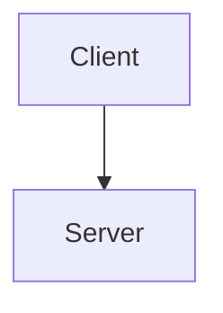

# inline

Intro written by hand.

<!-- cargo-rdme start -->

Crate with inline diagrams.

## Architecture



## Flow

The flow, rendered framed and left-aligned in rustdoc:

````mermaid
sequenceDiagram
    Alice->>Bob: ```code``` in a message
````

## Usage

Reference a diagram like this (this example must stay text):

```rust
#![doc = simple_mermaid::mermaid!("does/not/exist.mmd")]
```

## Again


The end.

<!-- cargo-rdme end -->

Footer written by hand.
